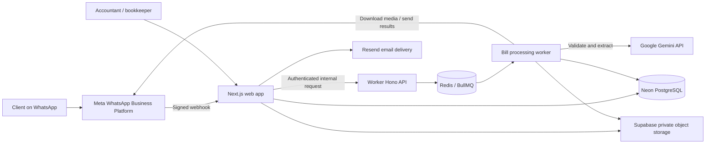

# Billraklo

**Take client invoices from WhatsApp to your books.**

Billraklo helps chartered accountants and bookkeepers collect bills from clients, extract invoice information, review it against the original document, and prepare purchase reports. Clients can send images or PDFs to a WhatsApp business number; accountants work in a web dashboard organized by client.

The application is under active development. The repository contains the web application, a separate background worker and HTTP API, and a shared data/service package. It is not a fully offline application: local development still requires configured external services.

## Use cases and features

- **Collect client bills:** register a client's legal name, GSTIN, and WhatsApp number, send a welcome template, and receive their invoice attachments.
- **Extract invoice details:** process PDFs, JPEG, PNG, and WebP files; extract supplier and buyer GSTINs, invoice numbers and dates, line items, HSN codes, tax amounts, and totals. One document can produce multiple invoice entries.
- **Review by client:** view the original document, correct extracted values, and confirm bills before reporting.
- **Add bills through the dashboard:** upload documents for extraction or enter bill details manually. Web uploads are limited to 10 MB.
- **Reduce duplicate processing:** track WhatsApp message IDs and compare document hashes within a client.
- **Prepare reports:** filter reviewed purchases, export CSV, generate Tally purchase-voucher XML for a selected client and ledger configuration, or use the browser's print/save-as-PDF flow.
- **Manage account access:** email/password authentication, email verification and password reset, Google sign-in, account settings, and light/dark themes.

Tally integration currently produces an export file; it does not establish a live connection to a Tally installation. AI output requires human review, and the app does not submit tax returns.

## Architecture



### Web application � `apps/web`

Next.js App Router and React provide the landing page, authentication screens, dashboard, client management, bill review, and reports. Tailwind CSS and Base UI components provide the interface.

Server actions and route handlers perform account and ownership checks before reading or changing data. Better Auth manages sessions, email/password credentials, Google sign-in, verification, and account recovery. `proxy.ts` handles early route redirects; protected pages and operations still validate the session on the server.

`/api/webhook` handles Meta's verification challenge and incoming WhatsApp events. Incoming POST requests are checked against the Meta app secret. Relevant messages are matched to registered client numbers, recorded, and submitted to the worker API. Delivery events update client welcome-message status.

The browser does not receive storage credentials, Meta tokens, Gemini keys, or the worker service secret.

### Worker and API � `apps/worker`

A separate Node.js process runs both:

- A **Hono HTTP API**, normally on port `8787`, which accepts authorized enqueue requests and exposes `/health`.
- A **BullMQ consumer** for the `bills` queue, with concurrency `5`, that downloads, stores, validates, and extracts documents.

The API has two queue endpoints:

| Endpoint | Authorization | Purpose |
| --- | --- | --- |
| `GET /health` | None | Process health response; not a complete dependency readiness check. |
| `POST /api/queue/bills` | Better Auth session and bill ownership | Enqueue a bill for a signed-in user. |
| `POST /api/internal/queue/bills` | `x-api-key` matching `WORKER_API_SECRET` | Server-to-server enqueue requests from the web app. |

Queue POST bodies contain a `billId` and an `action` of `process` or `extract`. `process` is the default. Keep the internal service key on the server.

### Shared package � `packages/core`

`@billraklo/core` exports TypeScript source consumed by both applications. It contains:

- Prisma schema, migrations, generated client, and the Neon database adapter.
- Shared Better Auth configuration and client/bill access helpers.
- WhatsApp messaging and media-download functions.
- Supabase S3-compatible storage helpers.
- Redis connections, BullMQ queues, retry settings, and job types.
- Invoice schemas, extraction prompts, and money conversion helpers.

It is a library, not a third HTTP service. Prisma generates the client into `packages/core/generated/prisma`.

## How a bill moves through the system

1. An accountant registers a client and their WhatsApp number. The current phone-number helpers support Indian mobile numbers.
2. Meta delivers an image/PDF message to `/api/webhook`. The web app checks the signature, tracks the message ID, and matches the sender to a registered client.
3. The web app creates a `Bill` record and asks the worker API to enqueue a `process` job.
4. The consumer downloads the attachment from Meta, checks its type and size, hashes it, and stores the original in Supabase. Matching files for the same client are marked as duplicates.
5. Gemini checks whether the document is processable as a bill. Valid documents are queued for extraction.
6. Extraction loads the stored file, uses the configured Gemini model and structured invoice schema, and saves the extracted entries, confidence information, model information, and processing timestamps. Invoice summary amounts are stored as integer paise.
7. WhatsApp-origin bills receive processing messages and extracted results. The accountant reviews the original and extracted data, makes corrections, and confirms the bill.
8. Reviewed invoice entries feed the purchase register and exports.

Dashboard uploads take a shorter path: the web app stores the file first and requests an `extract` job. Manual-entry mode starts in `needs_review` without requiring AI extraction.

Typical states are `received`, `stored`, `extracting`, `extracted` or `needs_review`, and `reviewed`. Failed processing is recorded as `failed`; duplicate documents are marked `duplicate`.

BullMQ jobs retry up to three attempts with exponential backoff starting at five seconds. Completed job records are retained for approximately one day and failed job records for seven days under the queue cleanup settings. **Queue cleanup does not delete invoices, files, or client records.**

## Data model

```text
User
  +-- Session / Account                  Authentication and linked sign-in records
  +-- Client                             Legal name, GSTIN, WhatsApp number
       +-- Bill                          Original file, status, extraction/review metadata
            +-- BillEntry                One extracted or entered invoice
                 +-- InvoiceLine         Items, HSN, taxable value, tax rate

WaMessage                                Incoming WhatsApp message deduplication
Verification                             Email verification / recovery records
```

A client belongs to an account holder. Bills belong to clients, and access checks use that relationship. The current schema makes a client's WhatsApp phone number globally unique, so the same number cannot be registered independently under multiple account holders.

## Repository structure

```text
billraklo/
+-- apps/
�   +-- web/
�   �   +-- app/
�   �   �   +-- (auth)/                  Sign-in, verification, recovery
�   �   �   +-- (app)/                   Dashboard, clients, bills, reports, settings
�   �   �   +-- api/auth/[...all]/       Better Auth handler
�   �   �   +-- api/webhook/            Meta verification and incoming events
�   �   +-- components/                 Shared UI, navigation, branding
�   �   +-- hooks/                      Client-side UI helpers
�   �   +-- lib/                        Sessions, email, webhook parsing
�   �   +-- public/                     Landing artwork and logo assets
�   �   +-- proxy.ts                    Route access redirects
�   �   +-- .env.example
�   +-- worker/
�       +-- src/
�       �   +-- index.ts                Starts Hono and the BullMQ consumer
�       �   +-- api.ts                  Health and queue endpoints
�       �   +-- auth.ts                 Shared-session validation
�       �   +-- env.ts                  Worker configuration validation
�       �   +-- helpers/ai.ts           Invoice validation
�       �   +-- jobs/                   Process, extract, and recovery sweep logic
�       +-- .env.example
+-- packages/core/
�   +-- prisma/                         Database schema and migrations
�   +-- prisma7.config.ts               Prisma CLI configuration
�   +-- src/                            Shared services and domain helpers
�   +-- src/ai/                         Extraction prompt and invoice schema
�   +-- .env.example
+-- apps/web/public/policy.md           Public privacy policy source
+-- package.json                        Workspace commands
+-- pnpm-workspace.yaml                 Packages, dependency catalog, build permissions
+-- tsconfig.base.json                  Shared TypeScript settings
```

## Run locally

### 1. Prerequisites

Use **Node.js 22 or later** and **pnpm 12.8.1**, the package manager pinned in the repository.

For the complete workflow, configure:

- A **Neon PostgreSQL database**. The current runtime uses `PrismaNeon`; a normal local PostgreSQL connection is not a drop-in replacement without changing the adapter or providing a compatible proxy.
- A **Redis instance** reachable by both processes.
- A **Supabase private Storage bucket**, its S3 endpoint/region, and S3 access credentials.
- A **Meta app and WhatsApp Business Platform number**, access token, app secret, and approved welcome template.
- **Google OAuth credentials** for the configured sign-in provider.
- A **Google Gemini API key** and an extraction model available to that project. The separate invoice-validation model is currently hard-coded as `gemini-decision-1` in `apps/worker/src/helpers/ai.ts` and also requires access.
- A **Resend API key** for real email delivery. Local development can use verification codes printed in the web server console.

If you need a local Redis instance and have Docker installed:

```sh
docker run --name billraklo-redis -p 127.0.0.1:6379:6379 -d redis:7-alpine
```

If that container already exists, start it with `docker start billraklo-redis`.

### 2. Create the environment files

From the repository root, copy these files without overwriting existing configured files:

| Example | Local destination |
| --- | --- |
| `packages/core/.env.example` | `packages/core/.env` |
| `apps/web/.env.example` | `apps/web/.env.local` |
| `apps/worker/.env.example` | `apps/worker/.env` |

On PowerShell:

```powershell
Copy-Item packages/core/.env.example packages/core/.env
Copy-Item apps/web/.env.example apps/web/.env.local
Copy-Item apps/worker/.env.example apps/worker/.env
```

On macOS/Linux, use `cp` with the same source and destination paths. Run these copy commands only for destination files that do not already exist.

Fill every required blank in the examples. Shared database, Redis, storage, WhatsApp, Google OAuth, and Better Auth values must agree across all three files. The examples repeat shared settings deliberately: core imports and each process's environment loading should not be relied on to supply a variable after another module has already read it.

Generate a random secret with:

```sh
node -e "console.log(require('node:crypto').randomBytes(32).toString('hex'))"
```

Use one generated value for `BETTER_AUTH_SECRET` in all three files. Generate a **different** value for `WORKER_API_SECRET`, and use it in both web and worker files.

Local addresses should be consistent:

| Variable | Value |
| --- | --- |
| `BETTER_AUTH_URL` | `http://localhost:3000` |
| `WORKER_API_URL` (web only) | `http://localhost:8787` |
| `WEB_ORIGIN` (worker only) | `http://localhost:3000` |
| `WORKER_API_PORT` | `8787` |

Register `http://localhost:3000/api/auth/callback/google` as a Google OAuth redirect URI. Do not mix `localhost` and `127.0.0.1` for browser-facing authentication URLs.

Next.js loads `apps/web/.env.local`; the worker loads `apps/worker/.env`; core also loads `packages/core/.env`. Existing process environment variables take precedence over dotenv file values. No root `.env` file is needed for the documented workspace commands. Environment validation currently requires shared integration settings even when you only intend to use a subset of the interface. Never prefix these credentials with `NEXT_PUBLIC_` or commit populated environment files.

### 3. Install dependencies and prepare the database

Run from the repository root after configuring the environment files:

```sh
pnpm install
pnpm --filter @billraklo/core exec prisma generate --config prisma7.config.ts
pnpm --filter @billraklo/core exec prisma migrate deploy --config prisma7.config.ts
```

The repository names its Prisma configuration `prisma7.config.ts`, so the explicit `--config` argument is intentional. Use these commands for setup rather than relying on automatic discovery by the shorter root `db:generate` / `db:migrate` shortcuts. Migrations apply to the database specified in `packages/core/.env`; use a development database.

### 4. Start both applications

```sh
pnpm dev
```

Or run each process in a separate terminal:

```sh
pnpm --filter @billraklo/web dev
```

```sh
pnpm --filter @billraklo/worker dev
```

Open [the web app](http://localhost:3000). Check [worker health](http://localhost:8787/health), which should return `{"ok":true}`. This confirms that the HTTP server is responding, not that all external integrations work.

Create an account and verify its email. In development, the web server prints verification codes to its console. Add a test client and use a synthetic invoice to test upload, extraction, review, and report export.

### 5. Connect WhatsApp to the local web app

Meta cannot send webhooks directly to your machine's `localhost`. Expose **port 3000** through an HTTPS development tunnel, then configure Meta with:

- Callback URL: `https://YOUR-PUBLIC-TUNNEL/api/webhook`.
- Verification token: the same `VERIFY_TOKEN` set in the environment files.
- The WhatsApp `messages` webhook subscription.

Keep the tunnel running. The worker API can stay local because Next.js calls it server-to-server. Ensure the test sender is allowed by your Meta setup and registered as a client in Billraklo. Set `WHATSAPP_WELCOME_TEMPLATE` and `WHATSAPP_WELCOME_TEMPLATE_LANG` to the approved template and language in your business account.

Use `localhost:3000` for the dashboard during this setup. If you instead browse the app through the tunnel, adjust authentication origins and OAuth redirect configuration accordingly.

## Useful commands

| Command, from repository root | Purpose |
| --- | --- |
| `pnpm dev` | Start web and worker in watch mode. |
| `pnpm typecheck` | Run TypeScript checks across the workspace. |
| `pnpm lint` | Run lint scripts where defined; currently the web app. |
| `pnpm build:web` | Build the Next.js application. |
| `pnpm --filter @billraklo/web start` | Serve the built web application. |
| `pnpm start:worker` | Run the worker without file watching, using `tsx`. |

There is no separate compiled worker build script; production execution currently uses TypeScript through `tsx`. Starting the web app alone does not process background jobs. Building Next.js may require network access to fetch the configured Google Fonts.

## Troubleshooting and current limitations

| Symptom | What to check |
| --- | --- |
| Startup reports missing environment values | Fill all required values in the relevant examples. Some error text says `.env.local` even when the worker or core loader reads `.env`. |
| Database connects in a SQL client but fails in the app | Confirm compatibility with the Neon runtime adapter, the database URL, and applied migrations. |
| Verification email does not arrive | Check the development server console. Real delivery needs `RESEND_API_KEY` and a valid sender configuration. |
| Worker responds with `401` to an internal request | Match `WORKER_API_SECRET` in web and worker files; the header is `x-api-key`. |
| Bills remain `received` or `stored` | Check worker availability, API URL, Redis connectivity, queue logs, and the API key. |
| WhatsApp says a file is unprocessable | Inspect worker logs. The hard-coded validation model must be available; validation API errors currently return a negative result. |
| Extraction fails | Check `GOOGLE_GENERATIVE_AI_API_KEY`, `EXTRACT_MODEL`, model access, quotas, and document format. |
| A sender's bills are ignored | Register the sender's Indian WhatsApp number under a client and verify the Meta test-number restrictions. |
| Welcome message fails | Check the token, phone number ID, approved template name/language, and permission to contact the recipient. |
| Tally export is rejected | Select one client and supply valid ledger names; required invoice details and tax totals must be reviewed and consistent. |

Recovery sweep logic exists in `apps/worker/src/jobs/sweep.ts`, but the maintenance consumer and recurring scheduler are currently commented out in the worker entry point. Do not assume stuck bills are automatically re-enqueued after an outage. The webhook acknowledgment and worker queue are not one atomic transaction, so review processing failures after connectivity incidents.

Client deletion is blocked while associated bills exist. Full account/document deletion currently requires a manual operator request. See [the privacy policy](apps/web/public/policy.md) for the current process.

## Data handling during testing

The current setup uses the unpaid Gemini API. Use **synthetic invoices only**, without real personal information or confidential business data. The application sends document content to Google for validation and extraction; a privacy notice alone does not make confidential data suitable for unpaid processing. See the [Gemini API terms](https://aistudio.google.com/docs/terms) and [Billraklo privacy policy](apps/web/public/policy.md).

Keep the Supabase bucket private. Webhook payloads are currently logged, and development logs include verification codes, so treat logs as sensitive. Do not publish populated environment files, access tokens, exported client records, or real invoices with the repository.
